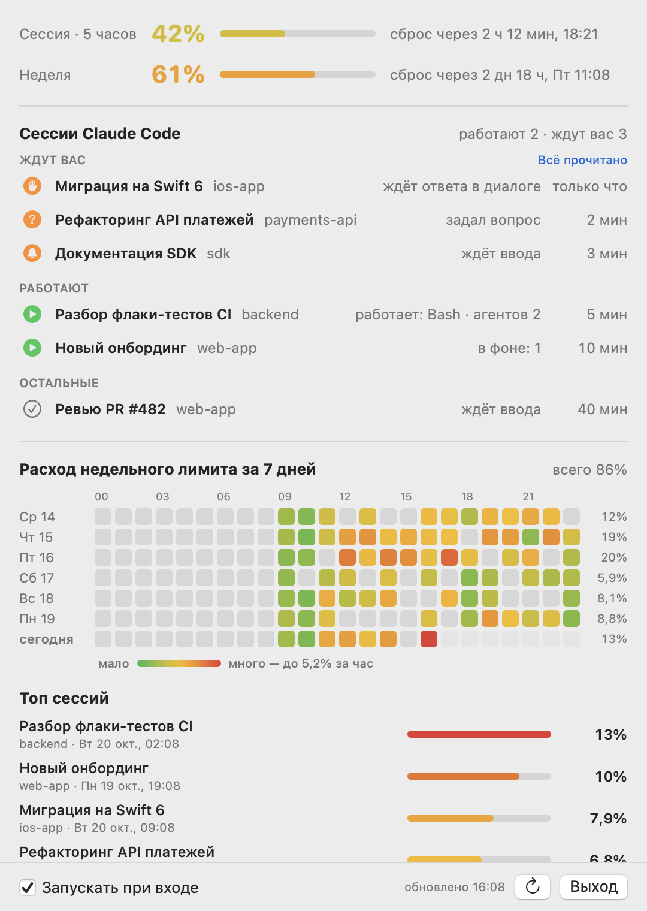
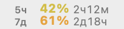
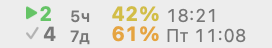
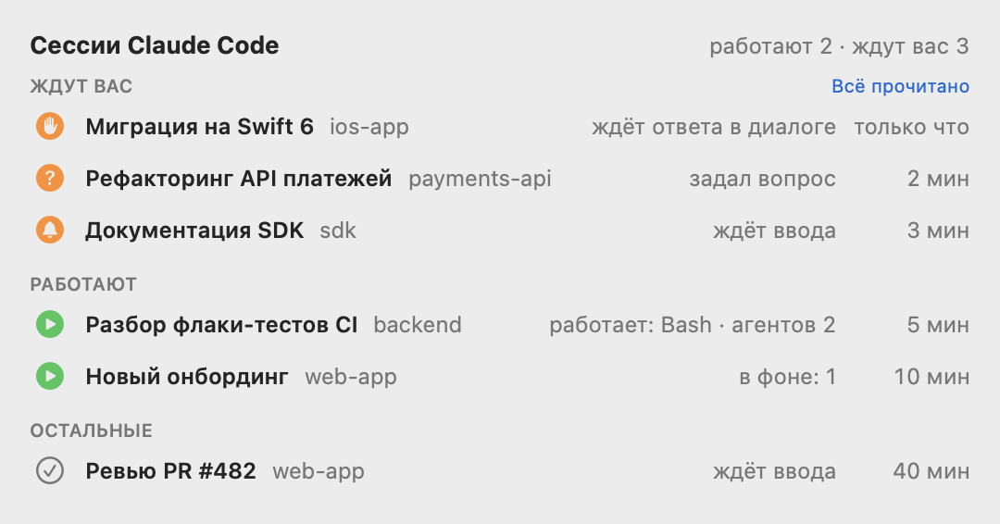
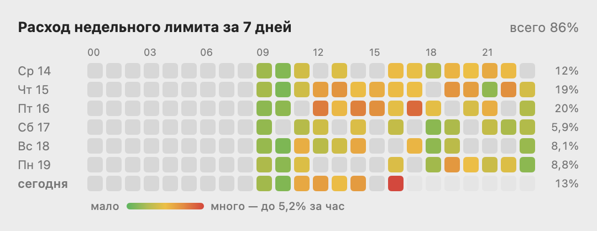
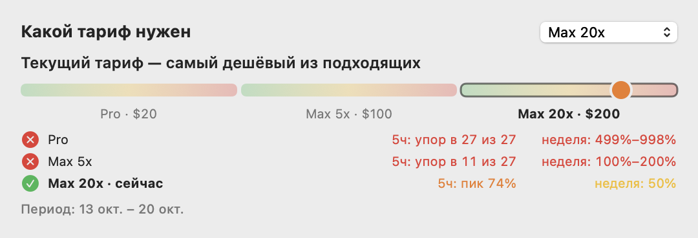

# Claude Limits

**Лимиты Claude и все ваши сессии Claude Code — в строке меню macOS.**

Сколько осталось от 5-часового и недельного лимита и когда сброс. Какие сессии Claude Code сейчас работают, а какие остановились и ждут вас: задали вопрос, просят разрешения или просто ответили. Клик по сессии — и вы в её окне: в VS Code, в Терминале или в Claude Desktop.

<p align="center">
  <picture>
    <source media="(prefers-color-scheme: dark)" srcset="docs/panel-dark.png">
    
  </picture>
</p>

## Что умеет

- **Лимиты всегда на виду.** Проценты 5-часового и недельного окна прямо в строке меню, цветом по темпу расхода, и время сброса.
- **Все сессии Claude Code в одном списке.** VS Code, терминал, Claude Desktop — видно, кто работает, кто трудится в фоне с субагентами, а кто ждёт вас.
- **Не пропустите, что Claude остановился.** Сессия, которая задала вопрос, просит разрешения или закончила ответ, подсвечивается оранжевым, пока вы на неё не посмотрите.
- **Переход в один клик.** Нужное окно VS Code и вкладка сессии, нужная вкладка Терминала или iTerm2.
- **Куда уходит лимит.** Тепловая карта расхода за неделю по часам и топ самых дорогих сессий.
- **Какой тариф вам нужен.** История вашего расхода, пересчитанная на Pro, Max и Ultra.

## Установка

Нужны macOS 14 или новее, Swift (Xcode или Command Line Tools) и [Claude Code](https://code.claude.com/docs), в котором вы вошли в аккаунт.

```bash
git clone https://github.com/alkbt-id/claude-limits-bar.git
cd claude-limits-bar
./scripts/install.sh
```

Скрипт соберёт приложение в `~/Applications/Claude Limits.app`, включит автозапуск при входе в систему и запустит его. Значок появится в строке меню.

Удалить приложение и автозапуск: `./scripts/uninstall.sh`.

### Разрешения macOS

Всё основное работает без них. Два разрешения включают удобства — macOS спросит о каждом, когда оно понадобится:

| Разрешение | Зачем | Как выдать |
| --- | --- | --- |
| **Универсальный доступ** | Сессия в окне VS Code, которое и так перед вами, не подсвечивается оранжевым | Кнопка «Разрешить» в панели под списком сессий → включить Claude Limits в «Конфиденциальность и безопасность → Универсальный доступ» |
| **Управление Терминалом или iTerm2** | Клик по сессии открывает её вкладку | Запрос появится при первом клике по терминальной сессии |

Разрешения сохраняются и после обновления приложения.

## Строка меню

<table>
  <tr>
    <td align="center">
      <picture>
        <source media="(prefers-color-scheme: dark)" srcset="docs/menubar-dark.png">
        
      </picture>
      <br><sub>кто-то ждёт вас</sub>
    </td>
    <td align="center">
      <picture>
        <source media="(prefers-color-scheme: dark)" srcset="docs/menubar-quiet-dark.png">
        
      </picture>
      <br><sub>никто не ждёт</sub>
    </td>
  </tr>
</table>

| Что видно | Что значит |
| --- | --- |
| ▶ **2** зелёным | сессий работает |
| 🔔 **3** оранжевым | сессий ждут вас |
| ✓ **4** серым | остальные сессии — показывается вместо 🔔, когда никто не ждёт |
| `5ч 42% 18:21` | потрачено 42% 5-часового окна, сброс в 18:21 |
| `7д 61% Пт 11:08` | потрачено 61% недельного лимита, сброс в пятницу в 11:08 |

На тарифе Ultra у подтверждённых аккаунтов 5-часового лимита нет: API его не отдаёт, и строка `5ч` пропадает из значка и панели. В значке наверх поднимается `7д`, а под ним встаёт `Fable 38% Пт 11:08` — сколько потрачено из недельного лимита на Fable. Порядок тот же, что в панели. Он входит в общий недельный, у него свой счёт процентов и в панели своя строка «Fable · неделя», на любом тарифе, где API его отдаёт.

Цвет процента — не сколько потрачено, а укладываешься ли в ровный темп до конца текущего часа (5-часовое окно, 20% в час) или дня (неделя, 100% / 7 в день). Часы и дни считаются целыми от начала окна, так что сразу после сброса первый час или день уже доступен и цвет зелёный. До полшага ниже этого лимита — зелёный, ближе — желтеет, лимит достигнут — красный. В панели под временем сброса написано «до 21% · лимит 29% до Чт 21:00»: до первого числа цвет зелёный, второе — сколько можно потратить до конца часа или дня; засечка на полосе стоит там же. Галочка «Недельный темп без выходных» в панели считает для недели только будни: суббота и воскресенье не входят в длину недели, неделя делится на 5 будних дней, и в выходные лимит не растёт. Столбец сессий виден, только пока запущен хотя бы один Claude Code. Клик по значку открывает панель.

## Сессии Claude Code

<p align="center">
  <picture>
    <source media="(prefers-color-scheme: dark)" srcset="docs/part-sessions-dark.png">
    
  </picture>
</p>

Все запущенные сессии разложены на три группы: **Ждут вас**, **Работают**, **Остальные**. У каждой — название, проект, состояние и сколько времени прошло.

| Значок | Состояние | Что происходит |
| --- | --- | --- |
| зелёный ▶ | работает | Claude думает или выполняет инструмент; видно, какой, и сколько запущено субагентов |
| зелёный ▶ | в фоне: N | ход закончен, но ещё работают субагенты или фоновые команды |
| оранжевая ладонь | ждёт ответа в диалоге | открыт запрос разрешения или другой диалог |
| оранжевая ладонь | ждёт разрешения? | догадка для VS Code и Claude Desktop — см. «Ограничения» |
| оранжевый вопрос | задал вопрос | Claude спросил вас и ждёт выбора |
| оранжевый список | план на одобрение | Claude предложил план и ждёт решения |
| оранжевый колокольчик | ждёт ввода | Claude ответил, а вы ещё не смотрели |
| серая галочка | ждёт ввода / остановлена | вы уже видели этот ответ или прервали ход |

Под сессией, у которой работают субагенты или команды, — вложенный список: задача каждого субагента и первая строка каждой команды.

**Оранжевая отметка снимается** сама, когда вы посмотрели на сессию:

- кликнули по ней в списке;
- нажали «Всё прочитано»;
- окно сессии и так впереди, и последнюю минуту вы работали за компьютером.

**Клик по сессии ведёт в её окно:**

| Где сессия | Куда ведёт клик |
| --- | --- |
| VS Code (расширение Claude Code) | в то самое окно и на вкладку сессии; новых окон и копий сессии не появляется |
| `claude` в Терминале или iTerm2 | на вкладку, где он запущен |
| `claude` во встроенном терминале VS Code | VS Code выходит на передний план |
| Claude Desktop, другие терминалы | приложение выходит на передний план |

## Куда уходит лимит

<p align="center">
  <picture>
    <source media="(prefers-color-scheme: dark)" srcset="docs/part-usage-dark.png">
    
  </picture>
</p>

Тепловая карта «день × час» за последние 7 дней: чем краснее клетка, тем больше потрачено в этот час. Справа — итог по дням, в заголовке — за неделю, всё в процентах недельного лимита. Наведите на клетку, чтобы увидеть точное значение.

Ниже — **топ сессий** текущей недели: какая сколько съела недельного лимита. Клик по сессии копирует команду, чтобы продолжить её в терминале: `cd <проект> && claude --resume <id>`.

## Какой тариф нужен

<p align="center">
  <picture>
    <source media="(prefers-color-scheme: dark)" srcset="docs/part-plan-dark.png">
    
  </picture>
</p>

Приложение запоминает пик каждого 5-часового окна и каждой недели. По ним за последние 28 дней видно, сколько раз вы упёрлись бы в лимит на Pro, Max и Ultra и какой тариф самый дешёвый из подходящих. У Ultra нет 5-часового лимита, поэтому он проверяется только по неделе. Ползунок показывает, где вы сейчас среди тарифов. Ваш тариф определяется автоматически, его можно сменить в списке справа. На подписке Team сравниваются места Team — Standard и Premium: перейти с места Team на личный тариф нельзя.

## Ограничения

- **Расход по логам — оценка.** Тепловая карта и топ сессий считают токены из локальных логов Claude Code по ценам API и пересчитывают их в долю недельного лимита. Чаты на claude.ai и работа на других компьютерах в логах не видны.
- **Запрос разрешения в VS Code и Claude Desktop — догадка.** Эти приложения показывают запрос у себя и никому о нём не сообщают. Поэтому «ждёт разрешения?» ставится, когда вызов инструмента висит дольше 10 секунд без каких-либо признаков работы. Чтобы долгий вызов — MCP-инструмент, который ждёт CI, или медленная загрузка страницы — не принимался за запрос, для VS Code проверяется лог расширения (`~/Library/Application Support/Code/logs/<время запуска>/window<номер>/exthost/Anthropic.claude-code/`): вызов, который там уже отмечен как запущенный, разрешение получил. Терминальный Claude Code сообщает о диалогах сам, там угадывать не нужно.
- **Claude Desktop и терминалы кроме Терминала и iTerm2** — по клику приложение только выходит вперёд, а отметка не снимается сама, когда окно впереди: какая именно сессия на экране, оттуда не узнать.
- **Без 5-часового лимита нет и 5-часовых замеров.** На Ultra API не отдаёт это окно, поэтому Pro и Max сравниваются с вашим расходом только по замерам, сделанным до снятия лимита. Когда они выйдут за 28 дней, сравнение пойдёт только по неделе.
- **Сравнение тарифов опирается на множители Anthropic.** Max — ×5 от Pro и за 5 часов, и за неделю, Ultra — ×10 за неделю. Для мест Team опубликовано только 5-часовое окно — Standard 1,25× и Premium 6,25× от Pro; для недели взято то же соотношение.

<details>
<summary><b>Как это работает</b></summary>

- **Лимиты** — `GET https://api.anthropic.com/api/oauth/usage` с OAuth-токеном Claude Code из связки ключей (`Claude Code-credentials`). Запрос раз в 2 минуты, но только если в логах Claude Code появилось что-то новое; без активности — раз в 30 минут и сразу после сброса окна. Кнопка «Обновить» запрашивает всегда. Если токен истёк (HTTP 401), запросы ждут, пока Claude Code не положит в связку ключей новый, — видны последние данные.
- **Запущенные сессии** — файлы `~/.claude/sessions/<pid>.json`, которые пишет сам Claude Code, логи сессий `~/.claude/projects/**/<id>.jsonl` (читаются с места, где остановились), метаданные субагентов `<id>/subagents/*.meta.json` и дерево процессов: команды — дочерние процессы `claude` в своей группе. Проверка раз в 3 секунды.
- **Окно VS Code для перехода** — номер окна берётся из логов текущего запуска VS Code (`~/Library/Application Support/Code/logs/<время запуска>/window<номер>/renderer.log` — какое окно запустило процесс `claude`), а переход идёт по ссылке расширения Claude Code `vscode://anthropic.claude-code/open?session=<id>&windowId=<номер>`.
- **Окно впереди** — у VS Code по заголовку `… — <папка>` через Универсальный доступ, у Терминала и iTerm2 — по tty выбранной вкладки через AppleScript.
- **История замеров** — `~/Library/Application Support/ClaudeLimits/samples.json` (30 дней), пики окон для подбора тарифа — `windows.json` там же (год).
- **Лог приложения** — `~/Library/Logs/ClaudeLimits.log`: запуски, запросы к API, смены состояний сессий, переходы. Смотреть: `tail -f ~/Library/Logs/ClaudeLimits.log`.

Подпись сборки привязана только к идентификатору приложения, поэтому выданные macOS разрешения переживают пересборку.

</details>

<details>
<summary><b>Разработка</b></summary>

```bash
swift build -c release
.build/release/ClaudeLimits --snapshot docs --demo   # картинки для README на выдуманных данных
.build/release/ClaudeLimits --sessions --watch       # что приложение видит о запущенных сессиях, раз в 3 секунды
```

</details>
